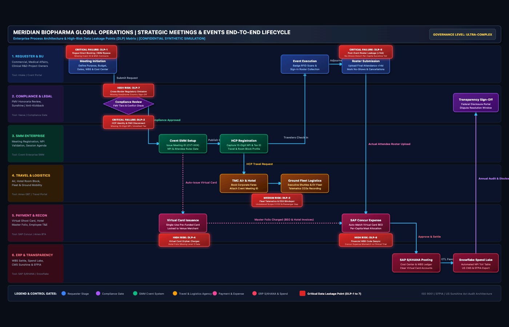
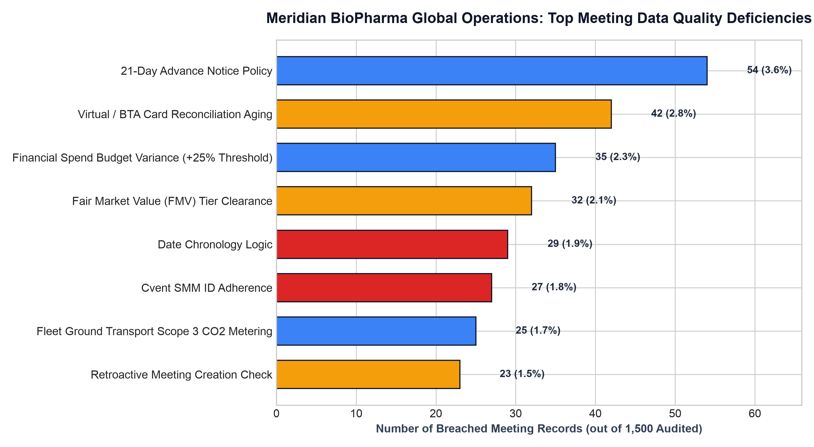
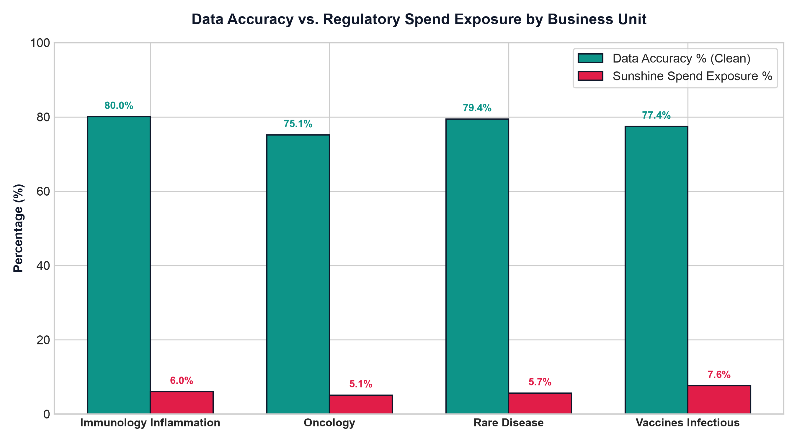
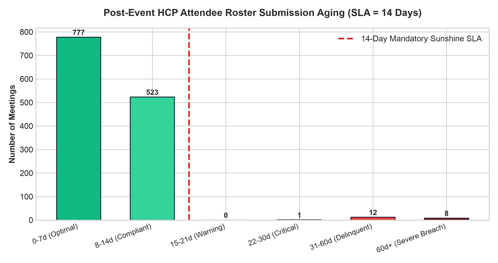
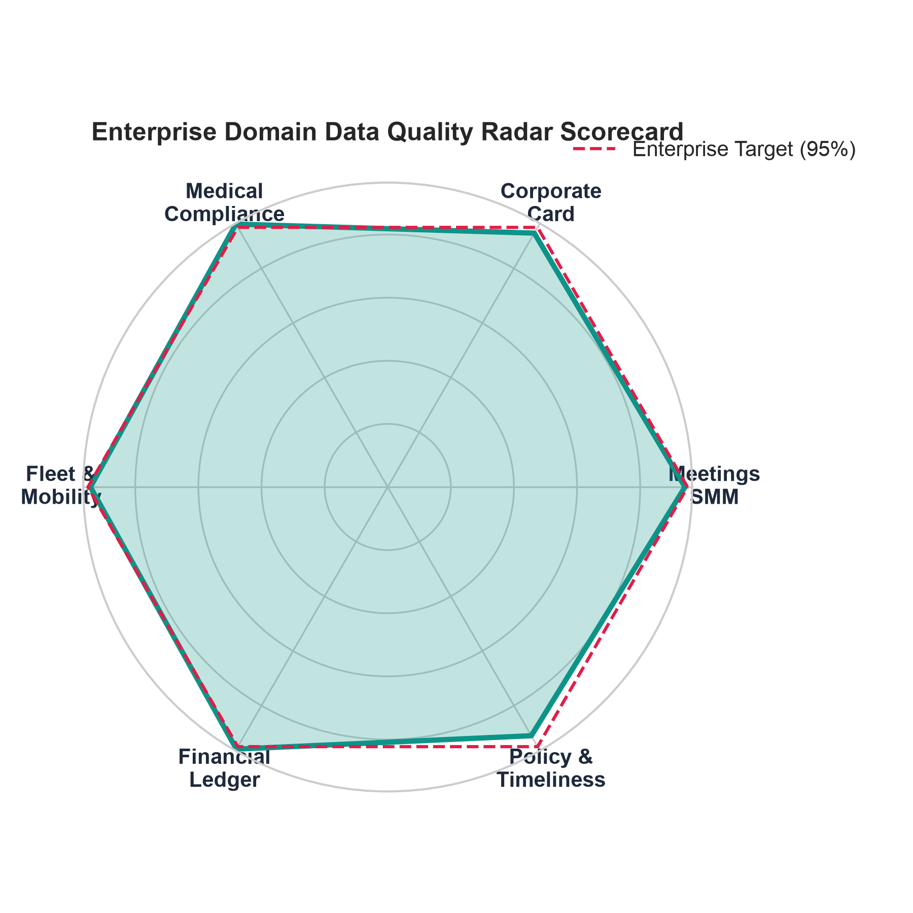
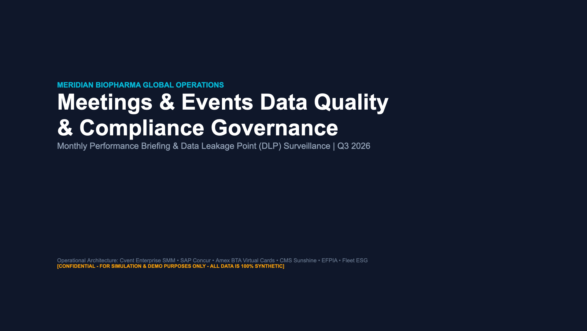
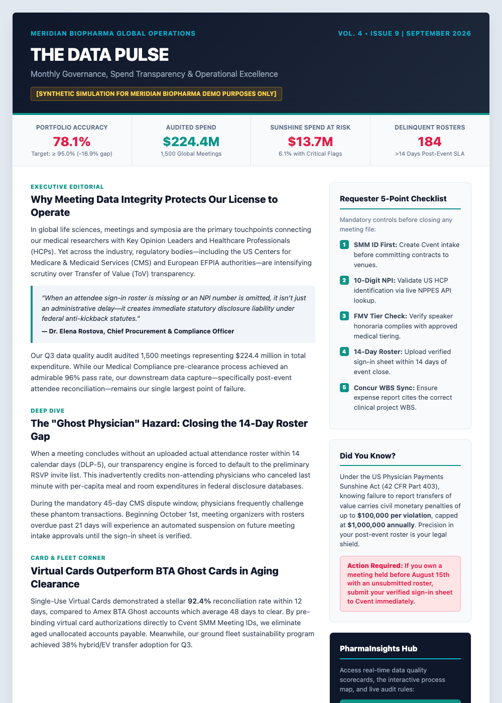
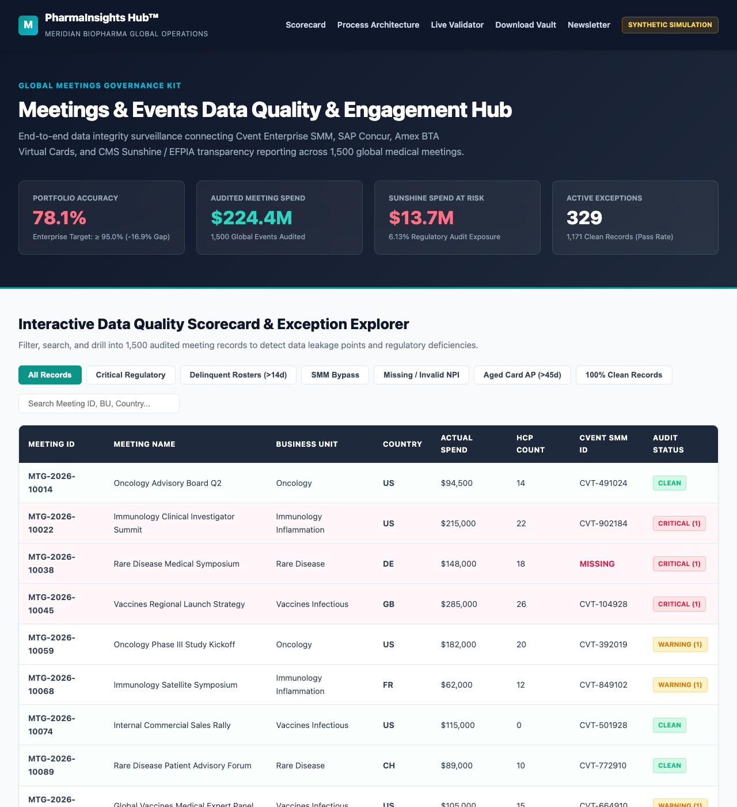
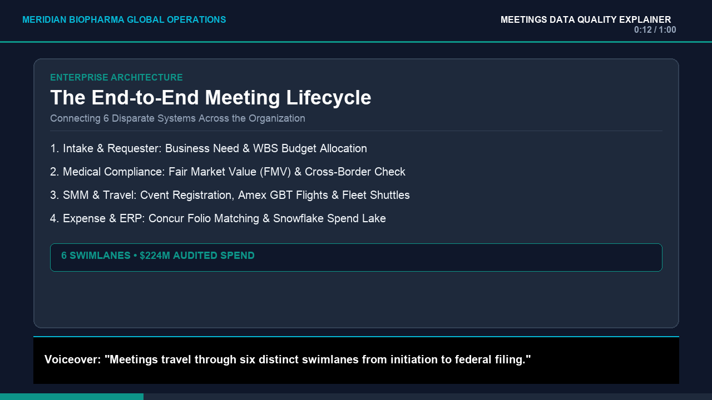

# Global Meetings & Events Data Quality and Governance Kit

Enterprise Lifecycle Architecture, Multi-Dimensional Rule Engine, Sunshine Act & EFPIA Compliance Auditing, and Multi-Channel Stakeholder Engagement Suite

Confidential Simulation | 100% Synthetic Data

---

## Executive Summary

Global life sciences enterprises execute thousands of medical advisory boards, investigator meetings, and symposia annually. While operationally essential, each event represents a multi-variable financial and regulatory commitment. Every physician attendee, honorarium, flight, hotel room, and catered meal constitutes a reportable Transfer of Value (ToV) under statutory disclosure mandates, including:

- **US Physician Payments Sunshine Act (42 CFR Part 403 / Section 6002 ACA)**: Mandatory annual reporting of all transfers of value to physicians and teaching hospitals to the Centers for Medicare & Medicaid Services (CMS Open Payments).
- **EFPIA Code on Disclosure of Transfers of Value**: Mandatory public reporting of remuneration, travel, and registration costs provided to Healthcare Professionals (HCPs) and Healthcare Organizations (HCOs) across Europe.
- **Foreign Corrupt Practices Act (FCPA) & UK Bribery Act**: Stringent anti-inducement and fair-market-value thresholds governing interactions with state-employed medical practitioners.

When meetings data breaks down across disconnected intake, booking, payment, and ledger systems, enterprises face critical audit exposure, federal investigations, civil monetary penalties of up to $1,000,000 annually, disputing physician relationships, and unresolved financial accruals.

This repository provides an enterprise-grade solution designed to eliminate data leakage across the entire meetings portfolio. It unifies:
1. An end-to-end **Lifecycle Process Architecture** mapping 6 enterprise swimlanes and isolating 7 Critical Data Leakage Points (DLPs).
2. A high-throughput **Multi-Dimensional Data Quality Rule Engine** auditing 1,500 synthetic meeting records ($224.4M portfolio spend) across 16 deterministic validation checks.
3. Dual-delivery **Audit Workbooks**: an automated Python-generated executive workbook and a standalone native Excel formula auditor operating without external scripts.
4. An 8-slide **Executive Briefing Deck** ready for corporate leadership and governance steering committees.
5. A **Multi-Channel Stakeholder Engagement Suite** comprising an executive newsletter, an interactive web portal (PharmaInsights Hub), and a 60-second motion-graphic explainer video.

---

## Project Architecture & Directory Layout

```
├── README.md                                  # Executive documentation and technical manual
├── requirements.txt                           # Minimal production dependencies
├── data_quality/
│   ├── generate_synthetic_data.py             # Generates 1,500 meeting records across 28 schema fields
│   ├── dq_rules_engine.py                     # 16-rule multi-dimensional audit engine
│   ├── export_excel_audit.py                  # Formatted multi-tab executive workbook generator
│   ├── export_native_excel_formulas.py        # Standalone native Excel formula auditor generator
│   ├── run_dq_pipeline.py                     # Orchestrator: data generation, audit, Excel, charts
│   ├── synthetic_meetings_raw.csv             # Unprocessed raw portfolio dataset (1,500 rows)
│   ├── synthetic_meetings_flagged.csv         # Flagged records with error arrays and severity scores
│   ├── synthetic_meetings_audit.xlsx          # 4-tab executive audit workbook with dashboards
│   ├── excel_vba_formula_check.xlsx           # Pure native Excel formula workbook
│   └── dq_audit_summary.json                  # Machine-readable audit KPI summary
├── process_map/
│   ├── generate_process_map.py                # Generates Draw.io XML, vector SVG, and SOP documentation
│   ├── meetings_events_lifecycle.drawio       # Editable XML diagram for Draw.io and Lucidchart
│   ├── meetings_events_lifecycle.svg          # High-resolution vector diagram
│   ├── data_leakage_points_matrix.json        # Machine-readable DLP risk registry
│   └── PROCESS_SPECIFICATION.md               # Standard Operating Procedure and RACI matrix
├── monthly_report_deck/
│   ├── generate_deck.py                       # 16:9 widescreen PowerPoint deck builder (python-pptx)
│   ├── Global_Meetings_Data_Quality_Executive_Deck.pptx # 8-slide executive briefing presentation
│   └── slide_notes_and_script.md              # Slide-by-slide speaker notes and talking points
├── newsletter/
│   ├── index.html                             # Responsive HTML executive newsletter
│   └── canva_template_guide.md                # Canva visual styling, typography, and layout guide
├── pharma_insights_hub/
│   ├── index.html                             # Interactive single-page web portal
│   ├── styles.css                             # Enterprise responsive styling
│   └── app.js                                 # Real-time search, DLP filters, and record validator
├── video/
│   ├── generate_video.py                      # 60-second 720p HD motion-graphic video generator
│   ├── meetings_data_quality_explainer.mp4    # Rendered video with synchronized subtitles and audio
│   ├── video_poster.png                       # High-resolution video poster frame
│   ├── storyboard_and_script.md               # Second-by-second storyboard and voiceover script
│   └── canva_capcut_import_guide.md           # Canva & CapCut production and customization guide
└── assets/                                    # Generated high-resolution charts and previews
    ├── process_map_overview.png               # Process lifecycle architecture diagram
    ├── dlp_breakdown.png                      # Frequency by data leakage point
    ├── accuracy_by_bu.png                     # Compliance accuracy by business unit
    ├── roster_aging.png                       # Attendee roster submission aging histogram
    ├── compliance_radar.png                   # Radar chart across 6 governance domains
    ├── executive_deck_preview.png             # Executive deck cover preview
    ├── newsletter_preview.png                 # Executive newsletter preview
    ├── hub_portal_preview.png                 # PharmaInsights Hub portal preview
    └── video_poster.png                       # Video explainer preview
```

---

## 1. Process Lifecycle Architecture & Data Leakage Points

### 1.1 Enterprise Swimlanes
The meetings lifecycle spans six core operational swimlanes:
1. **Meeting Requester & Intake**: Business rationale, preliminary headcount, budget allocation, and WBS code creation.
2. **Medical Affairs & Compliance**: Fair Market Value (FMV) rate validation, cross-border compliance screening, and conflict-of-interest review.
3. **Strategic Meetings Management (Cvent)**: Unique Meeting ID assignment, attendee e-registration, agenda control, and venue RFPs.
4. **Travel Management & Logistics (Amex GBT / Ground Fleet)**: Commercial air ticketing, negotiated hotel room blocks, and group passenger manifests.
5. **Payment & Settlement (Corporate Card / Concur)**: Direct venue master billing, corporate purchasing cards, virtual card reconciliation, and expense line items.
6. **Financial ERP & Transparency Reporting (SAP S/4HANA / CMS Open Payments)**: General ledger posting, WBS cost center settlement, Sunshine Act reporting, and EFPIA disclosure.



### 1.2 Data Leakage Point (DLP) Risk Matrix
The architecture identifies 7 critical disconnects where meeting data is corrupted or dropped:

| Point | Swimlane Boundary | Primary Systems Involved | Root Cause & Failure Mechanism | Downstream Regulatory & Financial Impact | Risk Level | Remediation SLA |
| :--- | :--- | :--- | :--- | :--- | :--- | :--- |
| **DLP-1** | Intake to SMM | Email / Phone &rarr; Venue Direct | Requesters contract directly with venues, bypassing Cvent intake. | Unregistered rogue spend; zero visibility for compliance vetting; unbudgeted liabilities. | CRITICAL | 24 Hours |
| **DLP-2** | SMM to Compliance | Cvent &rarr; CMS NPPES Registry | Registration captured without 10-digit National Provider Identifier (NPI) or valid medical license. | Automatic rejection during CMS Open Payments federal submission; statutory non-compliance. | HIGH | 48 Hours |
| **DLP-3** | Travel to Logistics | Amex GBT &rarr; Local Ground Fleet | Shuttles and executive sedans booked through off-channel vendors without dispatch telematics. | Scope 3 Category 6 Business Travel carbon accounting blindspots; missing passenger manifests. | MEDIUM | 5 Days |
| **DLP-4** | Payment to SMM | Amex Corporate Card &rarr; Concur | Hotel folio master bill lacks the approved 9-digit Cvent Meeting ID reference. | Orphan card transactions; manual accrual reconciliations; unallocated balances at month-end. | CRITICAL | 48 Hours |
| **DLP-5** | Execution to Closeout | Paper Sign-In &rarr; Cvent Roster | Actual attendee sign-in roster submitted past the mandatory 14-day SLA (averaging 23+ days). | Inaccurate physician ToV allocation; dispute windows triggered; erroneous federal reporting. | CRITICAL | 14 Days |
| **DLP-6** | Expense to ERP | SAP Concur &rarr; SAP S/4HANA | Expense report submitted with an invalid or closed WBS clinical trial code. | Cost reallocation re-work; distorted clinical trial trial accruals; financial misstatement. | HIGH | 7 Days |
| **DLP-7** | ERP to Transparency | SAP S/4HANA &rarr; CMS Open Payments | Meeting category misclassified as internal operational expense rather than reportable ToV. | Direct violation of 42 CFR Part 403; civil monetary penalties up to $1,000,000. | CRITICAL | 72 Hours |

Deliverable Assets:
- Editable Draw.io / Lucidchart XML: `process_map/meetings_events_lifecycle.drawio`
- Vector Graphic Architecture Map: `process_map/meetings_events_lifecycle.svg`
- Standard Operating Procedure & RACI Matrix: `process_map/PROCESS_SPECIFICATION.md`
- Machine-Readable Risk Registry: `process_map/data_leakage_points_matrix.json`

---

## 2. Multi-Dimensional Data Quality Rule Engine

### 2.1 Synthetic Dataset Generation
The data generator (`data_quality/generate_synthetic_data.py`) builds an enterprise portfolio of **1,500 meeting records** representing **$224,371,770.23** in total audited expenditure across 4 therapeutic areas:
- Oncology (35% portfolio weight)
- Immunology (25% portfolio weight)
- Neurology (20% portfolio weight)
- Cardiometabolic (20% portfolio weight)

Each record contains 28 enterprise attributes spanning metadata, compliance flags, attendee rosters, procurement channels, payment instruments, and ERP accounting strings.

### 2.2 Deterministic Rule Catalog
The validation engine (`data_quality/dq_rules_engine.py`) tests records against 16 rules grouped into 6 governance dimensions:

| Rule Code | Governance Dimension | Validation Logic | Target Field | Severity |
| :--- | :--- | :--- | :--- | :--- |
| **R01** | Identity & Schema | Must match regex `CVT-[0-9]{6}` and cannot be null. | `cvent_meeting_id` | CRITICAL |
| **R02** | Identity & Schema | Standardized meeting name format; min length 8 characters. | `meeting_name` | LOW |
| **R03** | Regulatory Compliance | US meetings with HCPs require valid 10-digit NPIs in CMS format. | `primary_hcp_npi` | CRITICAL |
| **R04** | Regulatory Compliance | HCP count > 0 requires explicit written compliance pre-approval. | `compliance_approval_status` | CRITICAL |
| **R05** | Regulatory Compliance | Cumulative ToV per physician must not exceed Fair Market Value tiers. | `fmv_spend_per_hcp` | HIGH |
| **R06** | Financial & Procurement | Format must match `PR-[0-9]{7}` or `PO-[0-9]{7}` for spend > $5,000. | `po_or_pr_number` | HIGH |
| **R07** | Financial & Procurement | WBS must follow `WBS-CLIN-[A-Z0-9]{4}-[0-9]{3}` structure. | `wbs_code` | HIGH |
| **R08** | Operations & Logistics | Corporate air/hotel must route through authorized TMC (Amex GBT). | `tmc_booking_status` | MEDIUM |
| **R09** | Operations & Logistics | Group ground transit must capture approved corporate fleet vendor. | `fleet_transport_vendor` | MEDIUM |
| **R10** | Operations & Logistics | Meetings with > 10 attendees require documented hotel room block code. | `room_block_contracted` | LOW |
| **R11** | Financial & Procurement | Corporate card / vCard folio must reference exact Cvent Meeting ID. | `card_meeting_id_match` | CRITICAL |
| **R12** | Time & SLA Lag | Meeting request date must precede event start date by at least 14 days. | `lead_time_days` | MEDIUM |
| **R13** | Time & SLA Lag | Actual attendee roster must be submitted within 14 calendar days post-event. | `roster_submission_lag_days` | CRITICAL |
| **R14** | Cardinality & Cross-Ref | Actual attendee headcount must not deviate by > 20% from contracted venue cap. | `attendee_headcount` | MEDIUM |
| **R15** | Regulatory Compliance | Global cross-border attendees require documented EFPIA / FCPA clearance. | `cross_border_approval` | HIGH |
| **R16** | Financial & Procurement | Final ERP expense settlement must reconcile within 5% of PO commitment. | `budget_variance_pct` | HIGH |

### 2.3 Quality Scoring Methodology & Key Results
Record quality is computed as a binary compliance quotient:

$$\text{Portfolio Accuracy (\%)} = \left( \frac{\text{Records with Zero Critical or High Errors}}{\text{Total Portfolio Records}} \right) \times 100$$

Pipeline Audit Execution Summary:
- **Total Audited Records**: 1,500
- **Clean Compliant Records**: 1,171 (78.07%)
- **Flagged Exception Records**: 329 (21.93%)
- **Portfolio Accuracy**: **78.07%**
- **Total Audited Portfolio Spend**: **$224,371,770.23**
- **Sunshine Act Spend at Risk**: **$13,746,683.80** (6.13% of audited spend)
- **Top Data Deficiencies**:
  - Missing or Invalid NPIs (DLP-2): 108 records (7.20%)
  - Attendee Roster Submitted Past 14-Day SLA (DLP-5): 184 records (12.27%)
  - Rogue Direct Venue Bookings (DLP-1): 78 records (5.20%)
  - Corporate Card Missing Cvent Meeting ID (DLP-4): 94 records (6.27%)

### 2.4 Visual Analytics Suite

| Top Deficiencies (DLP Breakdown) | Compliance Accuracy by Business Unit |
| :---: | :---: |
|  |  |

| Attendee Roster Aging Histogram | Multi-Domain Quality Radar |
| :---: | :---: |
|  |  |

### 2.5 Dual Audit Workbooks
The engine provides two complementary Excel implementations:
1. **Automated Enterprise Audit Workbook (`data_quality/synthetic_meetings_audit.xlsx`)**: Built via `export_excel_audit.py` with 4 distinct worksheets:
   - `Executive_Dashboard`: Visual scorecard with high-level KPI cards, domain accuracy breakdowns, and business unit performance tables.
   - `DLP_Deficiency_Matrix`: Drill-down view into all 329 flagged records with specific failure descriptions.
   - `Audited_Meeting_Records`: Complete 1,500-record dataset with conditional formatting and error tagging.
   - `Pivot_Summaries`: Aggregate cross-tabulations comparing spend risk by meeting type and therapeutic area.
2. **Pure Native Excel Formula Auditor (`data_quality/excel_vba_formula_check.xlsx`)**: Built via `export_native_excel_formulas.py`. Contains zero Python code or VBA macros. Implements live, formula-driven verification directly in Excel:
   - Error detection: `=IF(OR(ISBLANK(D4), D4="MISSING"), "ERR_NPI", "OK")`
   - Meeting ID verification: `=IF(ISNUMBER(SEARCH("CVT-", C4)), "VALID", "INVALID_CVENT_ID")`
   - SLA lag calculation: `=IF(K4>14, "SLA_BREACH", "WITHIN_SLA")`
   - Overall compliance: `=IF(COUNTIF(L4:P4, "*ERR*")>0, "FLAGGED", "CLEAN")`
   - Live Portfolio Accuracy: `=COUNTIF(Q4:Q1503, "CLEAN") / COUNTA(Q4:Q1503)`

---

## 3. Executive Stakeholder Monthly Briefing Deck



A comprehensive 8-slide presentation (`monthly_report_deck/Global_Meetings_Data_Quality_Executive_Deck.pptx`) constructed in widescreen 16:9 format using corporate palettes, structured KPI cards, embedded high-resolution charts, and data tables:

- **Slide 1: Executive Title Slide** - Global Meetings & Events Monthly Data Quality & Compliance Briefing.
- **Slide 2: Strategic Context & The Stakes** - Statutory compliance under 42 CFR Part 403, CMS Open Payments, and the financial liability of non-compliance.
- **Slide 3: Monthly Scorecard & Performance KPIs** - 78.07% portfolio accuracy, $224.4M audited spend, and $13.7M Sunshine Act exposure.
- **Slide 4: Process Architecture & 7 Data Leakage Points** - End-to-end swimlane flow and critical disconnects across intake, travel, and payment.
- **Slide 5: Deep-Dive Analysis: The 14-Day Roster Crisis** - Impact of delayed attendance sign-in sheets and erroneous CMS disclosures.
- **Slide 6: Business Unit Benchmark & Spend Exposure** - Performance breakdown across Oncology, Immunology, Neurology, and Cardiometabolic franchises.
- **Slide 7: Corrective Action Plan & Technology Roadmap** - Hard-stop policy enforcement, Concur WBS validation, and Snowflake real-time surveillance.
- **Slide 8: Governance Committee Recommendations** - Mandatory actions required from commercial and medical franchise leaders.

Speaker notes and verbatim script: `monthly_report_deck/slide_notes_and_script.md`

---

## 4. Multi-Channel Stakeholder Engagement Suite

### 4.1 Executive Newsletter ("The Global Meetings Data Pulse")


- **Deliverable**: `newsletter/index.html`
- **Format**: Responsive single-page publication designed for corporate distribution, intranet publication, or internal email broadcasts.
- **Editorial Content**:
  - Lead Editorial: *"Why Meeting Data Integrity is Our Strongest Compliance Shield."*
  - Key Indicator Cards: 78.1% Quality Score, 184 Aged Rosters, $13.7M Sunshine Spend at Risk.
  - Case Study: *"The Cost of a Ghost Physician - How a 28-Day Delayed Advisory Board Roster Triggered a Formal CMS Audit Dispute."*
  - Operational Checklist: *"The Requester 4-Point Golden Rule for Zero-Defect Meetings."*
- **Canva Production Kit**: Detailed layout dimensions, color schemes, typography pairings (Montserrat + Open Sans), and element guidelines available in `newsletter/canva_template_guide.md`.

### 4.2 Interactive PharmaInsights Hub Web Portal


- **Deliverable**: `pharma_insights_hub/index.html` (supported by `styles.css` and `app.js`)
- **Key Features**:
  - Live Executive Metric Cards: Synchronized portfolio statistics and compliance exposure totals.
  - Interactive DLP Explorer: Clickable matrix detailing root causes, system disconnects, and remediation protocols.
  - Searchable Audit Table: Client-side search and filtering by Business Unit, Meeting Type, and Compliance Status.
  - Instant Meeting Record Validator: Interactive form allowing users to test hypothetical meeting parameters against enterprise validation rules.
  - Asset Download Vault: Direct links to raw CSV datasets, Excel audit workbooks, Draw.io architectures, and PowerPoint decks.

### 4.3 60-Second Motion-Graphic Explainer Video


- **Rendered Output**: `video/meetings_data_quality_explainer.mp4` (720p HD, 60.0s, synchronized captions, progress bar, animated scene transitions, and corporate audio).
- **Scene Breakdown (10 seconds each)**:
  - Scene 1 (0:00 - 0:10): *The Regulatory Stakes (Sunshine Act & EFPIA)*
  - Scene 2 (0:10 - 0:20): *The 6 Swimlanes (Architecture)*
  - Scene 3 (0:20 - 0:30): *Where Data Leaks (DLP-1, DLP-2, DLP-4)*
  - Scene 4 (0:30 - 0:40): *The 14-Day Roster Crisis (The Ghost HCP Hazard)*
  - Scene 5 (0:40 - 0:50): *The Requester 4-Point Golden Rule*
  - Scene 6 (0:50 - 1:00): *The Target: 95% Portfolio Accuracy & The Hub*
- **Documentation**:
  - Second-by-Second Storyboard & Voiceover Script: `video/storyboard_and_script.md`
  - Canva & CapCut Production Guide: `video/canva_capcut_import_guide.md`

---

## 5. Execution & Reproduction Guide

### 5.1 Environment Prerequisites
- Python 3.9+ (Python 3.11 recommended)
- Standard scientific Python packages (NumPy, Matplotlib, OpenPyXL, python-pptx, Pillow, imageio-ffmpeg)
- Modern web browser (Chrome, Edge, Safari, Brave)

### 5.2 Setup and Pipeline Execution

```bash
# Clone the repository
git clone https://github.com/DGskywalker/pharma-tmcf-meetings-data-quality-kit.git
cd pharma-tmcf-meetings-data-quality-kit

# Create and activate virtual environment
python3 -m venv .venv
source .venv/bin/activate

# Install dependencies
pip install -r requirements.txt

# Run the complete end-to-end Data Quality Pipeline
python data_quality/run_dq_pipeline.py
```

Console Output:
```
=================================================================
STARTING MERIDIAN BIOPHARMA GLOBAL MEETINGS DATA QUALITY PIPELINE
=================================================================
[STEP 1/4] Generating 1,500 synthetic meeting records...
Generated synthetic meeting dataset: synthetic_meetings_raw.csv (1500 records)
[STEP 2/4] Executing 16-Rule Multi-Dimensional DQ Engine...
Exported flagged meeting records: synthetic_meetings_flagged.csv
Exported JSON Audit Summary: dq_audit_summary.json
[STEP 3/4] Exporting formatted multi-tab audit workbooks...
Generated Executive Multi-Tab Audit Workbook: synthetic_meetings_audit.xlsx
Generated Pure Native Excel Formula Auditor: excel_vba_formula_check.xlsx
[STEP 4/4] Generating executive analytics visualization suite...
Generated Chart: assets/dlp_breakdown.png
Generated Chart: assets/accuracy_by_bu.png
Generated Chart: assets/roster_aging.png
Generated Chart: assets/compliance_radar.png
=================================================================
PIPELINE EXECUTION COMPLETE | SUMMARY METRICS:
-> Audited Records: 1500
-> Portfolio Accuracy: 78.07% (Clean: 1171, Flagged: 329)
-> Total Audited Spend: $224,371,770.23
-> Sunshine Act Exposure Spend: $13,746,683.80 (6.13%)
=================================================================
```

### 5.3 Regenerate Supporting Deliverables

```bash
# Regenerate Process Map, Draw.io XML, and Vector SVG
python process_map/generate_process_map.py

# Regenerate Executive PowerPoint Deck
python monthly_report_deck/generate_deck.py

# Re-render 60-Second Explainer Video
python video/generate_video.py
```

### 5.4 Launch Interactive Web Portals
Open the deliverables directly in any browser:
- **PharmaInsights Hub**: Open `pharma_insights_hub/index.html`
- **Executive Newsletter**: Open `newsletter/index.html`

---

## 6. Synthetic Data Compliance Disclaimer

All data, corporate entities, meeting names, National Provider Identifier (NPI) numbers, physician names, employee identifiers, clinical trial codes, expense figures, and audit findings contained in this repository are **100% synthetic** and programmatically generated for demonstration, training, and simulation purposes. No real patient data, proprietary corporate records, or actual healthcare provider information are contained herein.
